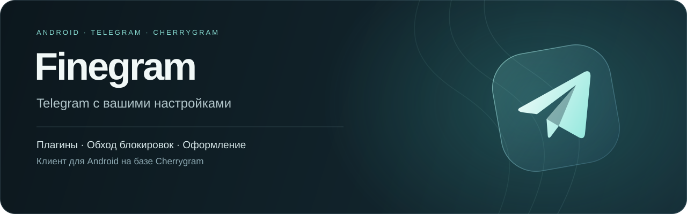

<p align="center">
  
</p>

<p align="center">
  <a href="https://github.com/Th3Nekit/Finegram/releases/latest"></a>
  <a href="https://t.me/th3nek1t_projects"></a>
  <a href="LICENSE"></a>
</p>

<p align="center">
  <a href="#скачать">Скачать</a> ·
  <a href="#возможности">Возможности</a> ·
  <a href="#сборка">Сборка</a> ·
  <a href="#лицензия">Лицензия</a>
</p>

Finegram — клиент Telegram для Android на основе [Cherrygram](https://github.com/arsLan4k1390/Cherrygram) и [Telegram for Android](https://github.com/DrKLO/Telegram). База — Telegram 13.1.1.

## Скачать

Готовые APK лежат в [релизах](https://github.com/Th3Nekit/Finegram/releases/latest) и в [канале](https://t.me/th3nek1t_projects). Установленный клиент сам предлагает обновиться.

- `arm64-v8a` подходит почти всем современным телефонам;
- `armeabi-v7a` нужен старым 32-битным;
- `universal` работает везде, но весит больше.

Нужен Android 7.0 или новее.

## Возможности

- **Обход блокировок.** Встроен в клиент, отдельный VPN не нужен. Можно выбрать наш сервер в Нидерландах, площадки Flowseal или смешанный режим: файлы идут через Flowseal, остальное через сервер. Если одна дорога закрыта, клиент сам переходит на другую. Есть свои прокси VLESS и Hysteria2.
- **Плагины.** Магазин, установка из файла, настройки и пункты в меню. Плагины exteraGram работают без переделки, Python-зависимости ставятся сами.
- **Приватность.** Режим призрака с исключениями, сохранение удалённых и изменённых сообщений, спрятанные люди.
- **Сообщения.** Невидимые чернила и капсула времени в личке, редактор цитат, меню сообщения в стиле iOS с открытием по удержанию.
- **Кружки и камера.** Выбор движка и камер, панель объективов, размытие фона и студийный свет в кружках.
- **Оформление.** Наборы значков, переключатели Material 3, папки внизу, обложки папок, шкала времени в чатах, стеклянная шапка.
- **Карты без ключей.** Google, 2ГИС и OpenStreetMap, в том числе в тёмной теме.

Объективы и режимы камеры зависят от телефона. Плагинам, которым нужны нативные библиотеки без сборок под Android, Python-окружение не поможет.

## Сборка

Понадобятся JDK 17, Android SDK 36 с Build Tools 36.0.0, NDK 27.2.12479018, CMake 3.22.1 и Python 3.11.

Сторонние библиотеки подключены сабмодулями:

```bash
git clone --recursive https://github.com/Th3Nekit/Finegram.git
```

В корне создайте `private.properties`:

```properties
TELEGRAM_API_ID=ваш_id
TELEGRAM_API_HASH=ваш_hash
KEYSTORE_PATH=/путь/к/своему.jks
KEYSTORE_PASSWORD=...
KEY_ALIAS=...
KEY_PASSWORD=...
```

API ID и hash выдаются на [my.telegram.org](https://my.telegram.org) в разделе API development tools. Ключ подписи нужен свой, наш в репозитории не лежит. Путь к SDK указывается в `local.properties` или в `ANDROID_HOME`.

Для push-уведомлений положите свой `google-services.json` в `TMessagesProj/` и `TMessagesProj_AppStandalone/`. Без него клиент держит своё соединение для уведомлений.

Ключ Google Maps не обязателен. Если хотите родные карты Google, задайте `GOOGLE_MAPS_API_KEY` в `private.properties` или переменной окружения.

```bash
./gradlew :TMessagesProj_AppStandalone:assembleAfatStandalone
```

APK окажутся в `TMessagesProj_AppStandalone/build/outputs/apk/afat/standalone/`.

Python-пакеты для плагинов скачиваются во время сборки. Если индексы пакетов недоступны, положите готовые колёса для обеих архитектур в каталог `wheels/` в корне.

## Устройство

| Каталог | Что там |
| :--- | :--- |
| `TMessagesProj/src/main/java/com/th3nekit/finegram` | код Finegram |
| `TMessagesProj/src/main/python` | среда для плагинов |
| `TMessagesProj/src/main/res-finegram` | ресурсы и переводы |
| `native/fghook` | перехваты для плагинов |
| `native/sources` | исходники собранных нативных библиотек |
| `server` | релей обхода и пример файлов обновлений |

## Лицензия

Проект ведёт [Th3Nekit](https://github.com/Th3Nekit).

В основе [Cherrygram](https://github.com/arsLan4k1390/Cherrygram) от [arsLan4k1390](https://github.com/arsLan4k1390) и [Telegram for Android](https://github.com/DrKLO/Telegram). Магазин плагинов использует части [PluginManager](https://git.kangel.xyz/KangelPlugins/PluginManager) от KangelPlugins (GPL-3.0), его лицензия лежит в [LICENSE.PluginManager](LICENSE.PluginManager).

Finegram распространяется под [GPL-3.0](LICENSE). Лицензия Telegram — в [LICENSE.telegram-gpl2](LICENSE.telegram-gpl2), сторонние компоненты перечислены в [NOTICE](NOTICE).
